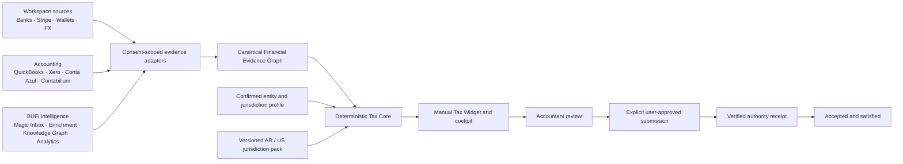
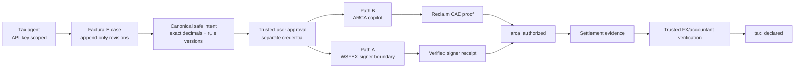

# Architecture and data flow

## Factura E agent backend

The agent never receives the user-approval or accountant-channel tokens. Reclaim requests are created server-side with the application secret, proofs are bound to the initiated session and case context, and accepted session IDs are persisted to prevent replay. WSFEX ambiguous recovery is pinned to the original request ID and hashed authority-payload reference.

Associated export notes 20/21 retain independent approval, authority, CAE, request-recovery, and original-document association inside the same immutable case. A derived exact-decimal ledger recomputes the authorized net balance without rewriting the invoice or settlement history. Raw verified Reclaim artifacts can cross only into the external encrypted proof-vault boundary; Motora stores normalized claims, attestation policy/results, and the opaque custody receipt.

The UI receives a `TaxWidgetSnapshotV1`, never raw evidence. Each conclusion carries source references, freshness, confidence, consent scope hash, evidence hash, accountant review state, rule versions, and limitations.

The system models these lifecycle dimensions independently:

1. preparation state;
2. accountant review state;
3. submission state;
4. authority receipt/acceptance state;
5. obligation satisfaction state.

An accepted authority receipt is required before an obligation can be marked satisfied.
