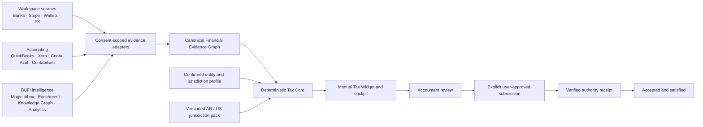

# Architecture and data flow

The UI receives a `TaxWidgetSnapshotV1`, never raw evidence. Each conclusion carries source references, freshness, confidence, consent scope hash, evidence hash, accountant review state, rule versions, and limitations.

The system models these lifecycle dimensions independently:

1. preparation state;
2. accountant review state;
3. submission state;
4. authority receipt/acceptance state;
5. obligation satisfaction state.

An accepted authority receipt is required before an obligation can be marked satisfied.
