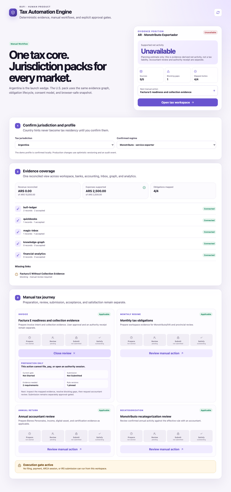
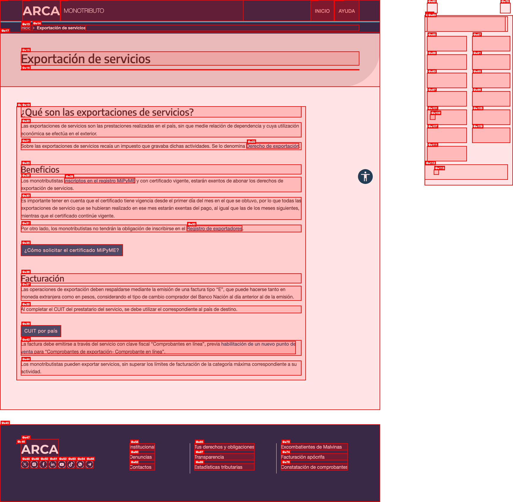
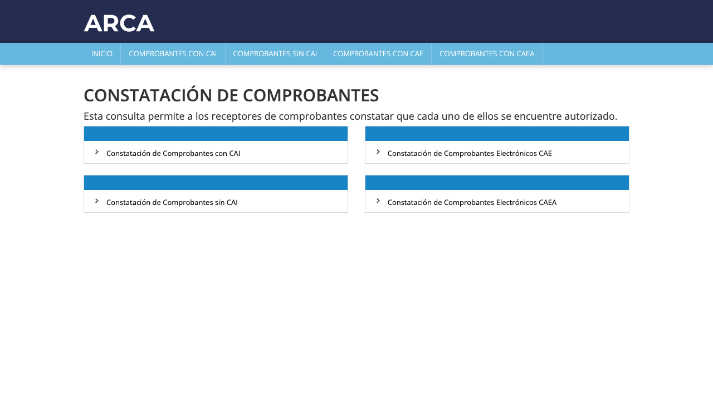
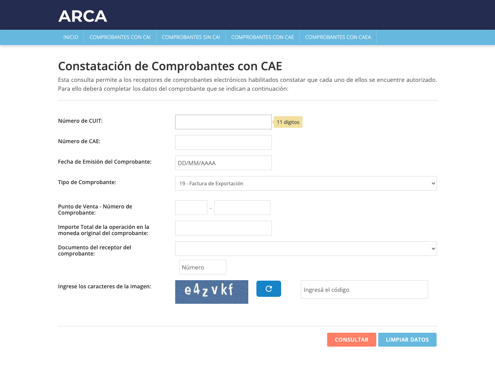
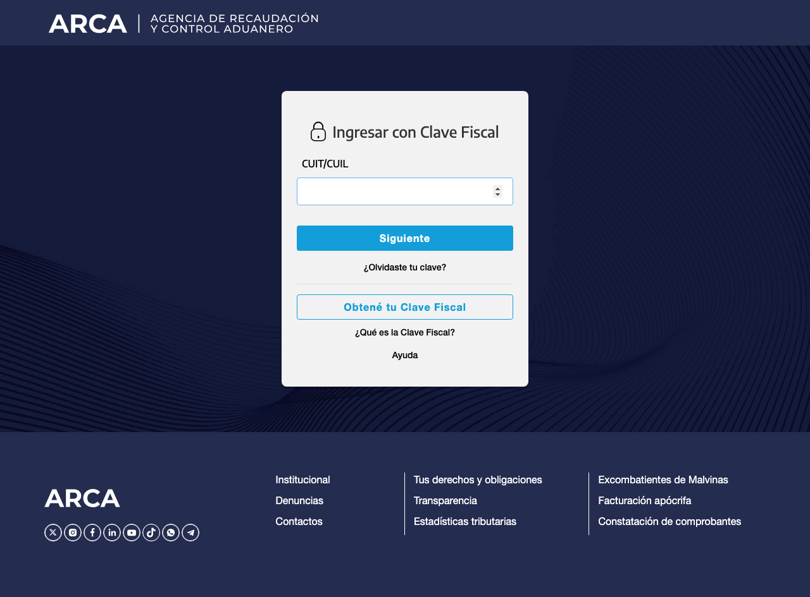
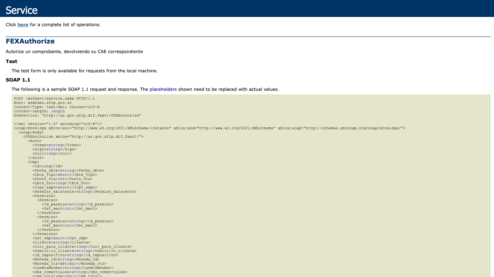

# Argentina Factura E / ARCA QA report

**Date:** 2026-07-11

**Product:** Motora / BUFI Tax Automation Engine

**Jurisdiction:** Argentina

**Scope:** Manual tax cockpit, public ARCA/AFIP surfaces, WSFEXV1 contract, Factura E validation controls, collection evidence, recovery/reclaim behavior, and the crypto-native receivables vision.

> **Historical discovery baseline.** This capture predates the Factura E backend subsequently
> merged into `development` through commits/PRs #1–#6 (`07147ac` through `af44673`). It is retained
> as public-portal and pre-implementation gap evidence; statements describing missing local WSFEX,
> WSAA, encrypted custody, homologation, or agent workflow code are not the current implementation
> status. Live authority validation, production credentials, and production release remain gated.

## Executive verdict

**Release verdict at capture time: NOT READY to issue or claim validation of a production Factura E.**

The current product is a sound manual readiness and evidence cockpit. It correctly keeps preparation, accountant review, user-approved submission, authority acceptance, and satisfaction separate. The local quality gate passes, the Argentina journey is usable, and the UI explicitly blocks filing, payment, and ARCA sessions.

It is not yet an ARCA invoice issuer. There is no WSFEX payload model, WSAA/certificate boundary, export point-of-sale verification, `FEXAuthorize` client, CAE result ingestion, public CAE re-verification, WSFEX recovery loop, export credit/debit-note flow, or binding between the authorized receivable and its stablecoin/foreign-exchange evidence. Therefore, **Invoice Class E validation is not verified end to end**.

No Clave Fiscal, certificate, private key, production taxpayer identity, or real invoice was used. No production authorization call was attempted.

### Findings by severity

| Severity | Finding | Consequence |
|---|---|---|
| P0 | The product cannot create, authorize, retrieve, or independently verify a Factura E/CAE. | It must not present “issued,” “ARCA accepted,” or “government compliant” states. |
| P0 | The product vision calls the invoice a “government-backed IOU.” ARCA authorizes the tax document; it does not guarantee customer payment. | Use **government-authorized commercial receivable**, not sovereign/government-backed debt. |
| P0 | Direct stablecoin settlement is not, by itself, proof of compliant ingreso de divisas. | Do not market “clean/legal income” without the applicable bank/authorized-FX and tax evidence. |
| P0 | The USD 36,000 annual cap is outdated. BCRA Communication A 8330 removed the cap for the individual mechanism on 2025-09-18. | Replace limit-based product rules and copy with effective-dated rule logic. |
| P1 | No WSFEX-specific reclaim/recovery protocol exists. | A network timeout could create ambiguity, duplicate intent, or a broken invoice-number sequence. |
| P1 | ARCA sources conflict on the exchange-rate label: the monotributo page says Banco Nación **comprador**; RG 4401 and WSFEX validation describe **vendedor divisa**. | Do not hardcode a quote rule until the effective authority behavior is confirmed in homologation and reviewed by an Argentine accountant. |
| P1 | The public ARCA-branded comprobante URL produced a TLS common-name error, while the legacy AFIP host redirected successfully to the ARCA-styled service. | Use a configurable, monitored verification endpoint and retain the result as evidence; do not depend on one hostname. |
| P2 | The UI says knowledge graph and financial analytics are connected while both contain zero accepted records. | Distinguish “connector configured” from “evidence available.” |

## What was verified

### Local product

`bun run check` passed on 2026-07-11:

- Type checks passed for core, ERP, web, and API packages.
- 27 tests passed; 0 failed; 122 expectations.
- Production builds passed for all packages.
- Browser QA confirmed Argentina and `Monotributo · service exporter` selectors.
- The cockpit shows the blocking `Factura E Without Collection Evidence` gap.
- The Factura E review action states that it cannot file, pay, or open an authority session.
- The page-level execution gate states that no ARCA session can run.

### Official public ARCA/AFIP surfaces

| Surface | Result | Evidence |
|---|---|---|
| ARCA export-services guidance | PASS | Public page loaded and states that service exports require a type E invoice, a country CUIT, Clave Fiscal “Comprobantes en línea,” and a separate export point of sale. |
| Clave Fiscal authentication gate | PASS, read-only | Public gate loaded and requested CUIT/CUIL. No identifier or password was entered. |
| Public comprobante constatement landing page | PASS via legacy host | Legacy AFIP URL redirected to the ARCA-styled CAI/CAE/CAEA validation service. |
| Public CAE validation form | PASS, schema only | Form exposes issuer CUIT, CAE, issue date, comprobante type, point of sale, number, total, recipient document, and CAPTCHA. |
| Factura E selection | PASS, schema only | The public validator exposes `19 - Factura de Exportación`, `20` export debit note, and `21` export credit note. |
| WSFEX homologation `FEXAuthorize` documentation | PASS, reachability only | HTTPS endpoint returned the SOAP request/response contract and CAE result fields. |
| WSFEX `FEXGetCMP` and `FEXGetLast_CMP` documentation | PASS, reachability only | Both homologation operation pages loaded. |
| Real CAE authorization | NOT RUN | Requires an authorized taxpayer, certificate/WSAA context, configured export point of sale, and explicit production authority. |
| Real CAE constatement | NOT RUN | No real invoice/CAE was created or supplied. The CAPTCHA was not bypassed. |

## Authoritative Factura E rules used for QA

The current QA baseline is:

1. A service export is a service performed in Argentina whose economic use occurs abroad.
2. The operation must be backed by an electronic export invoice class E.
3. Type `19` is the export invoice; type `20` is the export debit note; type `21` is the export credit note.
4. Service export uses operation code `2`.
5. Export points of sale must be distinct from domestic points of sale and distinct across issuance methods.
6. Numbering must be sequential.
7. The authorization request may be made within five calendar days before or after the invoice date; a request made before the invoice date must be in the same calendar month.
8. Destination country is required.
9. A service invoice requires a payment date, and the date cannot precede the invoice date.
10. A foreign-currency invoice requires an allowed currency and the applicable prior business-day quote. The present official source discrepancy must be resolved before implementation.
11. ARCA grants or rejects authorization and returns a CAE for each authorized document. The document has no tax effect against third parties until CAE authorization.
12. An authorized document is not edited or deleted. A correction is made through an associated export credit or debit note.

Primary sources:

- [ARCA: Exportación de servicios](https://arca.gob.ar/monotributo/exportacion-servicios/)
- [ARCA Resolución General 4401/2019 — vigente](https://biblioteca.arca.gob.ar/search/query/norma.aspx?p=t%3ARAG%7Cn%3A4401%7Co%3A3%7Ca%3A2019%7Cf%3A21%2F01%2F2019)
- [ARCA WSFEXV1 developer manual v3.1.1](https://www.arca.gob.ar/ws/documentacion/manuales/WSFEX-Manualparaeldesarrollador_V3.1.1_ARCA.pdf)
- [Public CAE constatement](https://servicioscf.afip.gob.ar/publico/comprobantes/cae.aspx)

## Factura E validation matrix

Legend: **PASS** is implemented and verified locally; **PARTIAL** is represented but is not authority-grade; **MISSING** is absent; **EXTERNAL** requires a real authorized authority context.

| Control | Authority expectation | Current product | Status |
|---|---|---|---|
| Jurisdiction/regime | Confirm Argentina and taxpayer regime | Argentina/Monotributo, RI, and company selectors exist | PASS |
| Economic-use test | Service performed locally and used abroad | Only `exports_services` boolean; no attestation or evidence model | PARTIAL |
| Taxpayer eligibility | Active tax identity and applicable regime/activity | User-confirmed profile; no ARCA status verification | PARTIAL |
| Export point of sale | Separate, enabled point of sale for chosen issuance method | `export_pos_ready` boolean only | PARTIAL |
| Document class | `Cbte_Tipo=19` | No Factura E payload type | MISSING |
| Export operation | `Tipo_expo=2` | Not modeled | MISSING |
| Request identity | Unique, monotonic `Cmp.Id` | Generic workflow idempotency exists; WSFEX request ID does not | PARTIAL |
| Invoice number | Next sequential `Cbte_nro` by point/type | No `FEXGetLast_CMP` or sequence allocator | MISSING |
| Invoice date | Five-day authorization window and same-month rule where applicable | Not validated | MISSING |
| Destination | Required destination-country code | Not modeled in invoice intent | MISSING |
| Foreign customer | Name, address, country CUIT and/or tax identity | Not modeled in invoice intent | MISSING |
| Currency | Allowed ARCA currency code | Not modeled | MISSING |
| Currency quote | Authority-compatible prior-business-day quote | No quote service or pinned provenance | MISSING |
| Same-currency indicator | `CanMisMonExt` where applicable | Not modeled | MISSING |
| Payment date | Mandatory for service invoice and not before invoice date | Not modeled | MISSING |
| Line items | Description and exact decimal quantities/prices/totals | Exact-decimal core exists; no WSFEX serializer/validator | PARTIAL |
| WSAA authorization | Short-lived token/signature for delegated `wsfex` certificate | Signer URL variables only; no implementation | MISSING |
| Authorization | Call `FEXAuthorize` in homologation/production | No client | MISSING |
| CAE acceptance | Persist result, CAE, expiry, observations, errors, response hash | Generic receipt hash/status only; CAE fields absent | PARTIAL |
| Independent verification | Re-check authorized invoice through retrieval/public validator | Not implemented | MISSING |
| Ambiguous response recovery | Exact replay with same request ID; retrieve authorized document | Not implemented | MISSING |
| Corrections | Associated type 20/21 document; never mutate original | Not implemented | MISSING |
| Collection link | Reconcile invoice with accepted settlement | Blocking gap exists | PASS |
| FX/bank evidence | Prove applicable ingreso de divisas treatment | Not modeled | MISSING |
| Stablecoin evidence | Chain, asset, amount, tx, parties, valuation, fees, reversals | Not modeled | MISSING |

**Class E validation result: 2 PASS, 6 PARTIAL, 17 MISSING. Authority execution remains EXTERNAL and untested.**

## Required reclaim and recovery protocol

“Reclaim” has two distinct meanings and must not be collapsed:

- **Technical recovery:** recover the authoritative outcome after timeouts or ambiguous network responses.
- **Economic correction/recovery:** adjust an authorized invoice, reverse or correct a settlement, and preserve the receivable’s legal and accounting history.

### A. Pre-authorization

1. Build a canonical invoice intent with exact decimal values and an effective-dated rule version.
2. Include taxpayer, point of sale, document type `19`, operation type `2`, invoice date, payment date, destination, foreign customer identity, currency, quote provenance, line items, total, and payment terms.
3. Obtain explicit user consent and accountant approval for the exact payload.
4. Freeze and hash the canonical payload. A later material change creates a new reviewed intent.
5. Obtain the last authorized document number for the point/type with `FEXGetLast_CMP` and the last request ID with `FEXGetLast_ID`; allocate the next values transactionally.

### B. Authorization and ambiguous-response recovery

1. Submit once through the isolated signer/provider boundary.
2. Persist a safe attempt record before sending: payload hash, request ID, point of sale, proposed invoice number, environment, and correlation ID. Do not persist the private key, Clave Fiscal PIN, or raw WSAA credentials.
3. On a timeout or broken connection, **do not create a new request ID and do not advance to a different invoice intent**.
4. Replay the exact request with the same `Cmp.Id`. WSFEX uses the request ID to return the already-authorized result as a reprocess or to process it if it had not been completed.
5. If still ambiguous, query `FEXGetCMP` by type, point of sale, and number, and reconcile with `FEXGetLast_CMP`/`FEXGetLast_ID`.
6. Accept only a verified response with an accepted result and CAE. Persist CAE, expiry/date, result, reprocess flag, observations, errors/events, response hash, and verified timestamp.
7. An error or rejection remains an immutable attempt. Correct the draft, re-run approval when material fields changed, and allocate identifiers according to the authority result—not by guessing.

### C. Post-authorization correction

1. Never edit or delete the authorized Factura E.
2. Use one associated export credit note (`21`) or debit note (`20`) per adjusted export document, with the required country, currency, association, and date constraints.
3. Preserve a graph edge from the adjustment to the original invoice and recompute open receivable, tax evidence, and settlement allocation without erasing history.

### D. Settlement reversal or mismatch

1. A stablecoin refund, chargeback, wrong-chain transfer, or FX loss does not cancel the ARCA invoice.
2. Record the settlement/reversal as a separate immutable economic event.
3. Reconcile exact units, token decimals, fees, timestamps, wallet/party proofs, fiat valuation source, and bank/authorized-FX evidence.
4. If the commercial amount changes, route through the appropriate associated tax document after accountant review.
5. Freeze lending/factoring eligibility while the invoice is disputed, overdue, diluted, partially settled, reversed, or missing required exchange evidence.

## BCRA and stablecoin assessment

The launch narrative needs an effective-date correction. [BCRA Communication A 8330](https://www.bcra.gob.ar/archivos/Pdfs/comytexord/A8330.pdf), effective 2025-09-18, removed the USD 36,000 annual cap for the individual mechanism and allows the exception from mandatory liquidation without an amount limit. It also prohibits local entities from charging commissions for the relevant foreign-currency account credit, while allowing documented pass-through foreign-bank costs.

The remaining mechanism is not equivalent to “receive stablecoins anywhere and the income is compliant.” The BCRA framework is based on eligible service concepts, timely ingreso, accreditation to the person’s local foreign-currency account, an intervening authorized entity, genuine-operation documentation, exchange records, and tax neutrality. The official rules reviewed do not establish that an on-chain stablecoin transfer alone satisfies those conditions.

Product implications:

- Treat the USD 36,000 rule as superseded from 2025-09-18.
- Keep effective-dated BCRA rule versions because the public BCRA overview and older ordered text can lag the communication.
- Separate `stablecoin_received`, `invoice_authorized`, `foreign_currency_ingress_verified`, `tax_declared`, and `commercial_receivable_settled` states.
- Require bank/authorized-provider evidence and accountant/legal review before showing a “compliant ingress” badge.
- Avoid “tax-advantaged” as a blanket promise. The mechanism changes currency conversion treatment; it does not exempt the income from Monotributo/IVA/IIBB/Ganancias/Bienes Personales analysis.

## Relation to the receivables / RWA vision

The product can support the vision, but the legal and data semantics must be precise.

### Correct asset description

A Factura E with a valid CAE is a **government-authorized tax document evidencing a commercial receivable owed by the customer**. It is not a government-backed IOU, sovereign receivable, or government payment guarantee. The obligor remains the foreign customer.

### Required state separation

| State | Meaning | Evidence owner |
|---|---|---|
| `invoice_intent_approved` | User/accountant approved the exact draft | Motora workflow |
| `arca_authorized` | ARCA returned and Motora verified CAE | ARCA/WSFEX evidence |
| `workspace_accepted` | Customer/workspace acknowledged commercial terms or delivery | Contract/workspace evidence |
| `kyb_verified` | Relevant parties passed identity/business controls | Persona/KYB provider |
| `settlement_observed` | Funds or tokens moved | Bank/chain evidence |
| `fx_ingress_verified` | Applicable BCRA/bank evidence is present | Authorized entity/bank |
| `settlement_final` | Allocation survived finality, fees, refunds, and disputes | Evidence graph |
| `receivable_open` | Authorized amount less valid adjustments and settlements | Deterministic ledger |
| `finance_eligible` | Separate underwriting/legal policy permits financing | Credit/risk system |

Persona KYB and Chainlink ACE can strengthen party and policy evidence. They do not prove that ARCA authorized the invoice, that the customer accepted delivery, that the receivable is assignable, or that payment will occur.

### Payment score prerequisites

The score must be based on immutable, consented outcomes rather than invoice issuance volume alone:

- Time from issue/due date to final settlement.
- Partial payments, fees, FX differences, credit/debit notes, refunds, disputes, and write-offs.
- Customer concentration and repeated-customer history.
- Workspace acceptance/delivery evidence.
- CAE validity and BCRA/bank evidence completeness.
- Data provenance, stale-source handling, and exclusion of duplicates.

### Factoring/lending prerequisites

Before an Aave V4 or other lending integration, obtain jurisdiction-specific advice on receivable assignment, perfection, enforceability against a foreign obligor, lender/credit licensing, AML/KYC/KYB, sanctions, securities treatment, consumer/business lending boundaries, collections, privacy, and cross-border enforcement. The premium cannot be inferred from “invoice + CAE”; it must price expected loss, time to payment, dilution, disputes, concentration, FX, chain/settlement risk, and recovery cost.

## Recommended release gates

### Gate 0 — keep current manual product

- Preserve the no-credential, no-authority-session boundary.
- Correct USD 36,000 and “government-backed IOU” copy immediately.
- Label zero-record connectors as configured/empty, not evidence-connected.

### Gate 1 — authority-grade homologation

- Canonical Factura E intent and exact-decimal WSFEX validator.
- Effective-dated ARCA/BCRA rules with an accountant review flag.
- Isolated WSAA/certificate signer and explicit `wsfex` delegation.
- Export point-of-sale discovery/verification.
- `FEXAuthorize`, `FEXGetLast_ID`, `FEXGetLast_CMP`, and `FEXGetCMP` clients.
- Exact-replay recovery and immutable attempt/receipt store.
- CAE result/expiry/observation model and independent verification.
- Export credit/debit-note adjustment journey.
- Authorized homologation fixtures covering accepted, rejected, observed, timeout/reprocess, and adjustment cases.

### Gate 2 — compliant settlement evidence

- Stablecoin and bank/FX evidence schemas.
- Invoice-to-settlement allocations, partials, fees, refunds, and reversals.
- Bank/authorized-entity ingress proof and effective BCRA treatment.
- Separate workspace/customer acceptance and dispute states.

### Gate 3 — production authorization

- Security review, key custody/rotation, least-privilege delegation, audit retention, incident runbook, provider monitoring, and explicit owner approval.
- Production smoke test using a controlled taxpayer and low-risk real transaction, with accountant sign-off.

### Gate 4 — score and financing

- Historical validation, explainability, adverse-outcome review, anti-gaming controls, legal opinions, risk policy, and explicit financing approval.

## Final acceptance criteria for “Factura E validated”

The product may use that label only when all of the following are true:

1. The exact approved payload passed local validation.
2. It was submitted through an authorized WSFEX/ARCA boundary.
3. ARCA returned an accepted result and CAE.
4. Motora retrieved or independently constated the same invoice.
5. The authority response hash, request hash, point of sale, number, dates, total, CAE, and rule versions are retained safely.
6. Any timeout was closed through exact replay/retrieval, not a guessed retry.
7. The UI shows ARCA authorization separately from customer acceptance and payment.
8. Corrections use associated notes, and settlement reversals remain separate events.

Until then, the correct product state is **Factura E readiness — manual review required**.
