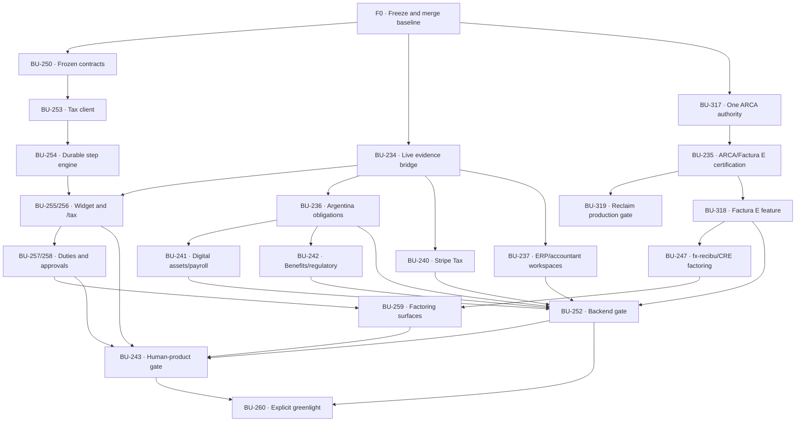

# Tax Automation Engine — closure plan

Status date: 2026-07-15

Programme issue: BU-232

Release gates: BU-252 (backend), BU-243 (human product), BU-260 (explicit agentic greenlight)

## Outcome

Ship the human Tax product for Argentina and the United States on one canonical evidence and workflow core. Argentina must support credentialless assisted ARCA onboarding, verified Factura E issuance and collection-to-tax continuity. The United States pack must support domestic and foreign-domiciled founders operating LLCs and corporations. Motora must expose durable Tax Widget and `/tax` projections sourced from the existing Desk financial platform.

The Tax Agent remains gated. Passing the backend and human-product gates does not automatically authorize agentic execution; BU-260 still requires explicit product-owner approval.

## Non-negotiable boundaries

1. Desk Invoice 2.0 is the authority for unfactored invoice settlement and publishes `InvoiceSettlementFinalizedV1` through BU-308.
2. Open Agents consumes the settlement event exactly once and invokes the existing Tax `record_settlement` transition through BU-309.
3. Tax Automation Engine owns deterministic fiscal interpretation, evidence projections and ARCA authority intents. It does not duplicate provider OAuth, payment webhooks or settlement ledgers.
4. Motora is the browser-safe human adapter. It must not create another WSAA client, certificate store, WSFEX/WSFE signer or tax calculator.
5. fx-recibu and standalone CRE own receivable/factoring lifecycle. `FacturaEFeatureV1` is a minimized, consented input; Payment Score is not settlement authority.
6. Reclaim proves minimum onboarding facts. It does not replace ARCA delegation, an active point of sale, the reviewed signer or authoritative API receipts.
7. No Clave Fiscal, portal cookie, raw proof, private key or provider credential enters browser contracts, logs or the canonical evidence graph.

## Baseline and freeze protocol

The current branch is based exactly on `origin/development` at `79d6595`. Its worktree contains 9,107 changed lines across 83 tracked files plus 82 untracked files. `bun run check` is green with 577 tests, full typecheck and all workspace builds.

No new feature work starts on this worktree until the baseline is captured as one integration PR with reviewable commits:

| Commit | Scope | Primary issues | Required verification |
|---|---|---|---|
| F0.1 | Browser contracts, `TaxCaseV1`, snapshots, safe errors and capabilities | BU-250 | Package surface tests, schema golden fixtures, compatibility report |
| F0.2 | Canonical evidence batches, graph, resolver, persistence and connector bridge | BU-234 | Replay/reordering, tenant isolation, consent rotation, mixed-currency conservation |
| F0.3 | ARCA onboarding, authority corridor, WSFEX signer hardening and homologation tooling | BU-235, BU-317, BU-319 | Exact recovery, signer isolation, no-secret scan, preflight fixtures |
| F0.4 | `FacturaEFeatureV1`, signed head, outbox, reservation and withdrawal | BU-318 | Golden vector, privacy allowlist, mutation fence, terminal receipts |
| F0.5 | Live onboarding UI, API client, user story and architecture documentation | BU-253, BU-254 | Browser tests, refresh/reconnect, credential boundary copy |

Freeze exit:

- every file is tracked and assigned to one commit;
- secrets and taxpayer identifiers are absent from the diff;
- `bun run check` passes from a clean clone;
- generated/dist artifacts are not committed unless package policy requires them;
- the integration PR links every represented Linear issue;
- `origin/development` is not advanced underneath the review without rebasing and rerunning the complete gate;
- after merge, all subsequent closure work branches from the new development SHA.

## Dependency graph

## Execution waves

### Wave 0 — capture the green baseline

Issues: BU-234, BU-235, BU-250, BU-253, BU-254, BU-317, BU-318, BU-319.

Actions:

1. Freeze the current branch and produce commits F0.1–F0.5 without changing behaviour.
2. Run secret/PII scanning, package-surface checks, `bun run check` and clean-clone verification.
3. Open one integration PR to development with a commit-to-issue matrix.
4. Reconcile Linear statuses only after the merged SHA proves the corresponding acceptance criteria.

Exit evidence: merged development SHA, clean worktree, green CI, issue-linked PR and reproducible test transcript.

Bucket effect: confidence in all bucket scores becomes attributable; contracts move toward 90%, security toward 95%, factoring substrate toward 90%.

### Wave 1 — live financial evidence and durable contracts

Issues: BU-234, BU-250, BU-253, BU-254. External prerequisites: BU-225, BU-226, BU-228 and BU-230 must land or expose stable versioned interfaces.

Deliverables:

1. Desk publishes incremental `TaxEvidenceBatchV1` records for accounting, bank, foreign account, wallet, Stripe, payroll, invoice/bill, Magic Inbox, enrichment, KG and Financial Analytics sources.
2. Source manifests preserve provider, capability, checkpoint, revision, consent scope and health.
3. Replay, reordering, supersession, reversal and DLQ recovery converge without double counting.
4. One durable browser projection provides `TaxCaseV1` and `TaxWidgetSnapshotV1`; production has no fixture fallback.
5. The country/entity/regime/evidence-scope step engine persists with optimistic concurrency and completion evidence.
6. Invoice settlement is consumed only through the already-complete BU-308 → BU-309 path.

Exit evidence:

- mixed USD/USDC/ARS golden workspace using every source class;
- disconnect/reconnect and stale-source scenarios;
- cross-tenant negative tests;
- refresh, new device and replay tests restore the same case revision;
- `loadDemoSnapshot` is unreachable in production mode.

Target buckets: HP1 Settlement 95%, HP3 Evidence 95%, Contracts 100%, Security 95%.

### Wave 2 — Motora Tax Widget and `/tax`

Issues: BU-255, BU-256, BU-257, BU-258. Prerequisites: Wave 1, BU-235 for authority actions and BU-317 for the Motora boundary.

Deliverables:

1. Replace the manual/demo widget with authenticated team-scoped `TaxWidgetSnapshotV1`.
2. Complete `/tax` with source health, reconciled financial position, evidence gaps, obligations, next actions, history and limitations.
3. Keep preparation, accountant review, filing/submission, authority acceptance and payment/satisfaction visibly separate.
4. Add Factura E human approval, frozen intent review, authoritative/ambiguous/reconciled states and canonical settlement state.
5. Add accountant packet generation as preparation evidence only; never label a packet as filed.
6. Meet responsive, keyboard, screen-reader and Spanish/English acceptance.

Exit evidence: seeded browser journey on desktop/mobile, reconnect test, approval replay test, a11y suite and no browser traversal of raw provider data.

Target buckets: Tax Widget/Page 95%, HP1 Settlement 100%, Contracts 100%.

### Wave 3 — ARCA and Reclaim production certification

Issues: BU-235, BU-317, BU-319. Required policy/security gates: BU-316 and BU-239.

Deliverables:

1. Approve signer identity, certificate custody, rotation policy and represented-CUIT delegation model.
2. Approve production Reclaim provider IDs, proof retention/deletion owner and browser negative proofs.
3. Guide a test taxpayer through service adherence, FEEWS point creation, WSFEX/WSFE delegation and explicit point selection.
4. Prove point-of-sale discovery through authoritative APIs; ZK evidence may corroborate but cannot advance the API gate alone.
5. Issue one Factura E in homologation, recover ambiguity exactly, reconcile CAE and bind the safe receipt to the frozen intent.
6. Perform a production dry run with issuance disabled, then require explicit owner approval before setting `productionEnabled=true`.

Exit evidence:

- active FEEWS point in a signed homologation report;
- at least one reconciled homologation Factura E and one fault/recovery case;
- verified no-credential browser transcript;
- reviewed certificate/signer runbook and rollback procedure;
- `productionEnabled` change controlled by a separate approval record.

Target buckets: HP2 ARCA 100%, Security 100%, Production certification 65%.

### Wave 4 — jurisdiction, ERP and accountant parity

Issues: BU-236, BU-237, BU-240, BU-241, BU-242, BU-251. External prerequisites: BU-219, BU-225, BU-226 and BU-230.

Argentina deliverables:

1. Effective-dated Monotributo, RI/IVA, IIBB and Bienes Personales obligation packs with primary-source citations.
2. Province-aware IIBB applicability and due calendars; unsupported municipalities fail to professional review.
3. Monotributo recategorization and annual evidence cases using reconciled activity rather than estimates.
4. MiPyME, Economía del Conocimiento, income certification and regulatory-change proposal workflows.

United States deliverables:

1. Confirmed entity/profile workflow for single/multi-member LLC, S-Corp and C-Corp with local/foreign founders.
2. Federal, state franchise/income, sales-tax nexus and payroll/information-return calendars.
3. Unsupported state/local rules park for professional review; no inferred elections or residency.
4. Stripe Tax contributes supported indirect-tax evidence only and never acts as IRS/state filing authority.

ERP, accountant and digital-asset deliverables:

1. Authorized Contabilium sandbox passes the shared conformance matrix; Colppy remains a separately gated follow-up if sandbox access is unavailable.
2. Scoped, expiring and revocable accountant mandates isolate every client workspace.
3. Digital-asset lots, cost basis, disposals, fees and provenance reconcile stablecoin invoice receipts and payroll allocations.
4. Accountant exports cite evidence, FX, rules and source-manifest revisions.

Exit evidence: accountant-reviewed golden cases for AR exporter, AR creative agency, foreign-founder US LLC and C-Corp; Contabilium sandbox transcript; crypto lot/reversal vectors; effective-date rollover tests.

Target buckets: Argentina 95%, United States 95%, ERP/accountant 90%, Crypto/payroll 95%.

### Wave 5 — factoring through fx-recibu and standalone CRE

Issues: BU-247, BU-318, BU-259. External prerequisites: BU-313, BU-315, BU-321, BU-326 and BU-336. BU-337 remains gated and is not required for non-Aave MVP factoring.

Deliverables:

1. Publish `FacturaEFeatureV1` only after reconciled official issuance and dedicated active consent.
2. Withdraw the feature on settlement, dispute, adjustment, expiry or consent revocation.
3. Pass the signed minimized feature to standalone CRE through the approved gateway.
4. Use Payment Score/healthy-financials only as underwriting inputs.
5. Present one identical factoring projection in Tax and Invoice 2.0.
6. Execute the E2E: issue Factura E → publish feature → receive offer → accept through governed CRE → settle/revoke eligibility.

Exit evidence: signed golden vector shared by Tax and CRE, privacy field allowlist, consent-revocation test, offer/lock receipt and settlement withdrawal E2E.

Target buckets: Factoring 100%, HP1 Settlement 100%, Security 100%, Production certification 80%.

### Wave 6 — release gates and agentic decision

Backend gate BU-252 requires:

- replayable AR exporter and US entity golden journeys;
- every backend dependency complete or explicitly removed from the gate by owner decision;
- tenant isolation, authority certification, fault matrix, provenance and durable persistence/outbox/job evidence;
- no fixture/provider fallback in production.

Human-product gate BU-243 requires:

- BU-253 through BU-259 complete;
- accountant portfolio BU-271 and mobile companion BU-272 completed, or explicitly removed from BU-243's MVP gate by the product owner;
- full Motora browser certification for taxpayer and accountant personas;
- factoring projection and approval UX certified against the canonical contracts.

Only after BU-252 and BU-243 are Done may BU-260 be evaluated. BU-260 requires an explicit recorded product-owner approval; it is not an automatic status transition.

Target buckets: every bucket at least 95%, HP buckets and security at 100%, aggregate score at least 95%, zero release-blocking missing criteria.

## Pull-request sequence

| PR | Depends on | Issues | Demo/proof hook |
|---|---|---|---|
| PR-F0 | Current green worktree | 234/235/250/253/254/317/318/319 | Clean development baseline with 577+ tests |
| PR-1A | PR-F0 + Desk connector contracts | 234 | Real workspace produces canonical evidence graph |
| PR-1B | PR-F0 | 250/253/254 | Refresh restores the same durable Tax case |
| PR-2A | PR-1A/1B | 255/256 | Widget opens a real `/tax` projection |
| PR-2B | PR-2A + ARCA boundary | 257/258 | Human approves Factura E and sees reconciled settlement |
| PR-3A | PR-F0 + BU-316/239 | 235/317/319 | FEEWS discovery and homologation Factura E without shared credentials |
| PR-4A | PR-1A | 236/242 | AR exporter gets cited obligations and benefits readiness |
| PR-4B | PR-1A | 251/240 | Foreign-founder LLC gets federal/state/nexus workflow |
| PR-4C | PR-1A + external connectors | 237 | Accountant opens isolated Contabilium-backed client |
| PR-4D | PR-4A + settlement | 241 | USDC receipt/payroll reconciles to accountant export |
| PR-5A | PR-3A + BU-239 | 318 | Signed consented Factura E feature published and withdrawn |
| PR-5B | PR-5A + CRE prerequisites | 247 | fx-recibu/CRE returns governed factoring decision |
| PR-5C | PR-2A/2B/5B | 259 | Tax and Invoice 2.0 show the same offer state |
| PR-6A | All backend PRs | 252 | AR/US backend release report |
| PR-6B | PR-6A + all UI PRs | 243 | Human product certification report |
| Decision | PR-6A/6B | 260 | Explicit owner greenlight or remain gated |

## Bucket parity trajectory

The score is evidence-based: `(done + 0.5 × partial) / criteria`, rounded down to 5%. A target does not change the score until its exit evidence exists.

| Bucket | Baseline | Wave reaching ship parity | Target before BU-260 |
|---|---:|---|---:|
| HP1 Settlement → Tax autopilot | 75% | Wave 2 | 100% |
| HP2 ARCA + credentialless Factura E | 80% | Wave 3 | 100% |
| HP3 Live financial evidence | 55% | Wave 1 | 100% |
| Browser contracts and durable state | 75% | Wave 1 | 100% |
| Argentina obligations | 50% | Wave 4 | 95%+ |
| United States pack | 50% | Wave 4 | 95%+ |
| ERP/accountant workspaces | 30% | Wave 4 | 90%+ |
| Tax Widget and `/tax` | 55% | Wave 2 | 100% |
| Crypto/stablecoin/payroll | 40% | Wave 4 | 95%+ |
| Factoring | 80% | Wave 5 | 100% |
| Security and isolation | 90% | Wave 3 | 100% |
| Production certification | 25% | Wave 6 | 100% |

Parity rule: no bucket may be hidden by a high aggregate. BU-252/243 cannot pass while any explicitly required bucket has a missing release criterion. The scorecard is recalculated at every wave exit from merged code and external evidence, never from issue status alone.

## Linear reconciliation required

Existing dependencies are mostly correct, but the closure programme must explicitly account for:

- BU-238 and BU-239, which block BU-252 and factoring/security work;
- BU-316, which blocks BU-235/319 production policy;
- BU-271 and BU-272, which currently block BU-243 although they were absent from the initial closure list;
- external connector/KG issues BU-219/225/226/228/230;
- standalone factoring issues BU-313/315/321/326/336;
- BU-318, currently Backlog although substantial code exists in the frozen worktree; status changes only after merge and acceptance verification.

No duplicate Linear issues should be opened for these responsibilities. The programme issue BU-232 should carry this wave plan, and each existing issue should receive only its wave, prerequisites and exit-evidence checklist.

## External environments and authority

| Integration | Configuration convention | Auth/custody | Closure requirement |
|---|---|---|---|
| ARCA WSAA/WSFEX/WSFE | Existing signer and boundary env vars | Certificate/private key outside repo; represented CUIT per call | Homologation signer, active FEEWS point, approved production identity and explicit enablement |
| Reclaim | `RECLAIM_*` | Reviewed provider IDs; encrypted proof vault | Production providers, retention owner, negative proofs and deletion runbook |
| Desk connectors | Existing Desk connector configuration | OAuth remains in connector platform | Versioned normalized events, checkpoints, replay and source health |
| Contabilium | Server-side sandbox configuration | Regenerable API credentials outside Tax browser | Authorized sandbox and conformance transcript |
| Stripe Tax | Existing Stripe server credentials | Server-side account/OAuth boundary | Jurisdiction allowlist and evidence-only Tax adapter |
| fx-recibu/CRE | Existing gateway/CRE configuration | Signed capability/receipt boundary | Golden `FacturaEFeatureV1`, governed offer and lock/settlement receipts |
| Accountant/e-file providers | Provider-specific, not yet selected | Scoped mandate/provider authorization | Packet handoff only until an authorized filing integration is selected |

Commercial tiers, quotas and production agreements must be recorded in the owning connector/ops issue before its production gate; they are not inferred in this plan.

## Definition of closed

The closure programme is complete only when:

1. development contains the frozen baseline and every subsequent closure PR;
2. the Desk-to-Tax bridge uses live canonical data with no production fixtures;
3. Motora uses durable Tax contracts for the widget and `/tax`;
4. an active FEEWS point and a reconciled homologation Factura E are evidenced;
5. Invoice 2.0 settlement advances Tax exactly once, including reversal/amendment cases;
6. AR and US golden journeys pass with accountant-reviewed effective rules;
7. Contabilium/accountant, digital assets/payroll and factoring E2Es pass;
8. BU-252 and BU-243 are Done with attached certification evidence;
9. every bucket meets its target with merged file/runtime evidence;
10. BU-260 remains gated until the explicit owner decision is recorded.
